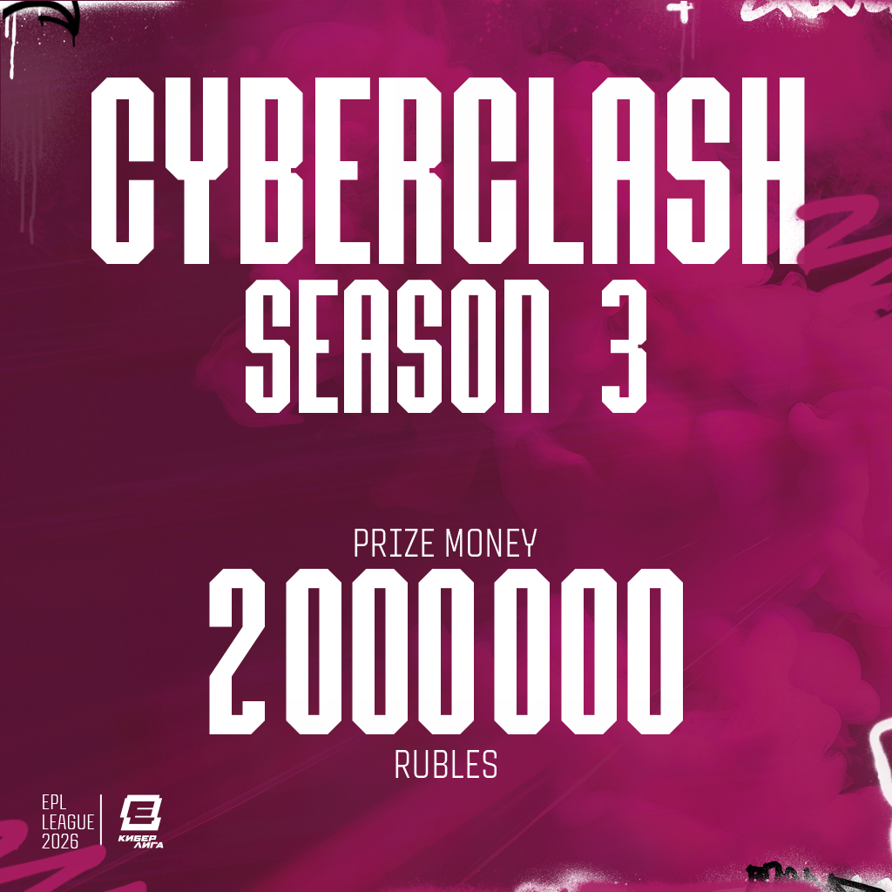

# CyberClash Season 3 LAN announcement and additional info

  

# Tournament info

- **Tournament VRS Tier** - VRS Tier 2 

- **VRS publication date used for seeding:** December 2026

- An official application will be submitted to HLTV.org for VRS inclusion. Please note that HLTV.org makes the final decision on which matches count towards the ranking.

# Tournament Format
Tournament contains following stages:

- Open Qualifiers Stage - (Online - Single Elimination BO1/BO3 for Semi-Final Matches - 29th of November, 30th of November 2026, 1st of December 2026, 6th of December 2026)
- Main Event Play-off Stage - Best 4 teams from Open Qualifiers Stage (LAN - 25th of December 2026 - 27th of December 2026 - Double Elimination BO3).

# Open Qualifiers

*Who can participate?*

*Any teams/mix with representatives from any country (Attention - Open Qualifiers will be played on European servers) - no sign-up fees*

# Open Qualifiers Links

**Open Qualifier №1 - 1 team advances to the main stage - 29th of November 2026**
- Registration will open 22nd of November 16:00 CET

[Registration link](https://www.faceit.com/ru/championship/c1f11bb8-2053-4348-ab8a-026ae46f3d0a/CyberClash%20Season%203%20LAN%20%7C%20Open%20Qualifier%201)

**Open Qualifier №2 - 1 team advances to the main stage - 30th of November 2026**
- Registration will open 22nd of November 16:00 CET

[Registration link](https://www.faceit.com/ru/championship/6f25913f-5c75-45c4-8680-c6eb5a1dfa53/CyberClash%20Season%203%20LAN%20%7C%20Open%20Qualifier%202)

**Open Qualifier №3 - 1 team advances to the main stage - 1st of December 2026**
- Registration will open 22nd of November 16:00 CET

[Registration link](https://www.faceit.com/ru/championship/b95cc5a3-3551-4ff9-90d2-f3ed05ea52d2/CyberClash%20Season%203%20LAN%20%7C%20Open%20Qualifier%203)

**Open Qualifier №4 - 1 team advances to the main stage - 6th of December 2026**
- Registration will open 22nd of November 16:00 CET

[Registration link](https://www.faceit.com/ru/championship/8e96cfec-ed00-437c-935e-f1e46d359862/CyberClash%20Season%203%20LAN%20%7C%20Open%20Qualifier%204)

# Prize Pool

Total Prize Pool of **Main event** is 2.000.000 RUB *(two million rubles)* - **~24 144 USD**

| Place | Prize |
| --- | --- |
|1 st place | 12 073 USD |
| 2nd place | 6 036 USD |
| 3rd place | 3 621 USD |
| 4th place | 2 414 USD |

# Visa/Location

**Location**: Europe (Online) for Open Qualifier part of tournament, Kazakhstan, Almaty for LAN part of tournament
- Please note that travel support/accommodation is not provided for LAN stage
**Venue**: VISION Gaming - Ryzen 7 9800x3D + 5080 RTX PCs

# Main Event Rulebook

*Main event rulebook will be shared with teams no later than 6th of December 2026.*

# Open Qualifiers Rules

[Open Qualifiers Rules](open-quals-rules.md)

# Disqualification and Technical Defeat Policy 

[Disqualification and Technical Defeat Policy](disqualification-and-technical-defeat-policy.md)

# Verifiability
- This Additional Information is published on a platform that preserves version history
